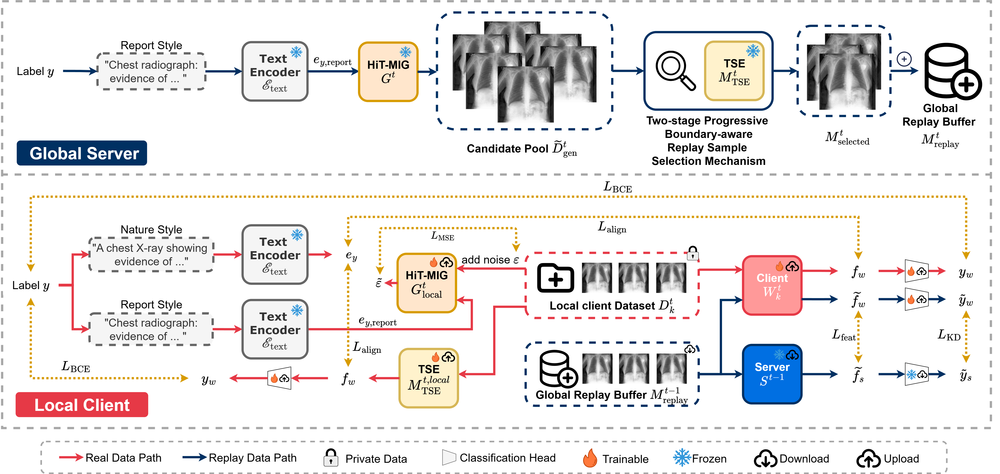

<div align="center">

# HB-FCL

**High-fidelity Boundary-aware Federated Continual Learning Framework for Medical Image Diagnosis**

<p>
  
</p>

<p>
  
  
  
</p>
*Source code for HB-FCL, a framework for medical image diagnosis.*

</div>

---

## Contents

- [Repository Layout](#repository-layout)
- [Environment Setup](#environment-setup)
- [Datasets](#datasets)
- [Running an Experiment](#running-an-experiment)
- [Results](#results)
- [Paper Training Configurations and Hyperparameters](#paper-training-configurations-and-hyperparameters)

---

## Repository Layout

```text
HB-FCL/
├── main.py                     # Command-line entry point for sequential federated training
├── methods/                    # Continual and federated learning algorithms
├── dataset/                    # Dataset adapters and preprocessing pipelines
├── convs/                      # Backbone and classifier implementations
├── utils/                      # Data partitioning, logging, CLIP text conditioning, synthetic-data utilities
├── forgetting_calculator/      # Forgetting metrics computed from saved AUC records
└── assist/                     # Optional scripts for TSE training and synthetic-data generation
```

## Environment Setup

The code has been tested on an **NVIDIA RTX 5880 Ada Generation 48G GPU**.

### 1. Install PyTorch

```bash
pip install torch==2.4.1 torchvision==0.19.1 --index-url https://download.pytorch.org/whl/cu121
```

### 2. Install Dependencies

```bash
pip install -r requirements.txt
```

### 3. Pretrained Model Checkpoints

The following pretrained models require local checkpoints; the code does **not** download their weights automatically.

| Component | Model |
|---|---|
| Diffusion model | [RoentGen-v2](https://huggingface.co/stanfordmimi/RoentGen-v2) (MINIM) |
| CLIP model | [kaveh/rclip](https://huggingface.co/kaveh/rclip) |

Download the checkpoints, place them in accessible locations, and specify their paths when running experiments (see the example below).

## Datasets

The loaders support four public chest X-ray datasets.

### 1. CXR

- **Source:** [CXR Dataset](https://www.heywhale.com/mw/dataset/62c2ac49913a54a66037f872)
- **Loader:** `dataset/CXR_with_split_Dataset.py`

### 2. ChestXR

- **Source:** [CXR COVID-19 Grand Challenge](https://cxr-covid19.grand-challenge.org/)
- **Alternative download:** [Google Drive](https://drive.google.com/file/d/1MRtZkovJS5iEl6W4ctkOsb1nAfTZU1r1/view?usp=drive_link)

### 3. CheXpert

- **Source:** [Kaggle CheXpert](https://www.kaggle.com/datasets/ashery/chexpert)
- **Preprocessing:**
  1. Combine the original `train.csv` and `val.csv` files.
  2. Re-split the combined data into `train.csv` and `val.csv` using an 8:2 ratio.
  3. Use the test set provided by [CheXlocalize](https://stanford.redivis.com/datasets/efx9-5nspnbb4b).
- **Label handling:** Exclude samples annotated with **Pneumonia, Enlarged Cardiomediastinum, Lung Lesion, Atelectasis, Pleural Other, Fracture,** or **Cardiomegaly**. Ignore the **Support Devices** label; samples with only this label are re-classified as **Normal**. *(Implemented.)*

### 4. NIH Chest X-rays 14

- **Source:** [Kaggle NIH Chest X-ray 14 (224×224 resized)](https://www.kaggle.com/datasets/khanfashee/nih-chest-x-ray-14-224x224-resized)
- **Preprocessing:**
  1. Split `train_val_list_NIH.txt` into `train.txt` and `val.txt` using an 8:2 ratio.
- **Label handling:** Exclude samples annotated with **Pneumonia, Consolidation, Pneumothorax, Emphysema, Fibrosis, Hernia,** or **Pleural Thickening**. *(Implemented.)*

> **Customization:** Dataset names and loading logic can be modified in `DataManager.dataset_map` in `utils/data_manager.py`.

## Running an Experiment

The following example runs HB-FCL across four sequential tasks:

```text
CXR → ChestXR → CheXpert → NIH14
```

### Example

```bash
python main.py \
    --illustration "HB-FCL" \
    --group=Ours \
    --exp_name=seed_2026_beta_0_2048to1024 \
    --pre 0.2 \
    --cur 0.8 \
    --r 0.015 \
    --tse_filter_radius 0.015 \
    --dataset_names CXR ChestXR CheXpert NIH14 \
    --classes 2 1 11 8 \
    --data_paths \
        "datasets/CXR/chest_xray" \
        "datasets/CXR/CXR_Covid-19_Challenge-001" \
        "datasets/CXR/CheXpert-v1.0-small" \
        "datasets/CXR/NIH_Chest_X_ray_14" \
    --method=ours \
    --net=densenet121 \
    --num_users 5 \
    --local_bs=64 \
    --beta=0.0 \
    --com_rounds 10 10 10 10 \
    --tse_com_rounds 10 10 10 10 \
    --local_lr 0.0001 \
    --weight_decay 1e-4 \
    --seed 2026 \
    --pre_nums 2048 \
    --nums 1024 \
    --minim_generation_batch_size 16 \
    --minim_pretrained_model_path '/HuggingFace_Model/stanfordmimi/RoentGen-v2' \
    --minim_train_batch_size 8 \
    --minim_gradient_accumulation_steps 4 \
    --minim_use_ema \
    --minim_resolution 256 --minim_center_crop \
    --minim_learning_rate 5e-6 \
    --minim_lr_scheduler constant \
    --minim_lr_warmup_steps 100 \
    --minim_com_rounds 10 \
    --minim_local_epochs 2
```

### Important Arguments

| Argument | Description |
|---|---|
| `--dataset_names` | Dataset names for each task; must match keys in `DataManager.dataset_map`. |
| `--classes` | Number of new classes introduced in each task, in the same order as `--dataset_names`. |
| `--data_paths` | Paths to the datasets, in the same order as `--dataset_names`. |

> **Important:** Keep the order of `--dataset_names`, `--classes`, and `--data_paths` consistent.

For the complete list of command-line options, run:

```bash
python main.py --help
```

## Results

By default, experimental results are saved under `result/`. Generated artifacts, including synthetic data and logs, are saved under `run/`.

## Paper Training Configurations and Hyperparameters

The configurations below summarize the settings used in the paper experiments.

### 1. Client Training (Classifier Backbone)

| Parameter | Value |
|---|---|
| Backbone | DenseNet121 |
| Total clients | 5 |
| Communication rounds | 10 |
| Local epochs | 2 per round |
| Batch size | 64 |
| Optimizer | AdamW |
| Initial learning rate | `1e-4` |
| $\beta_1$ | `0.9` |
| $\beta_2$ | `0.999` |
| Weight decay | `1e-4` |

### 2. Generator Network (`RoentGen-v2`)

| Parameter | Value |
|---|---|
| Base model | `RoentGen-v2`|
| Communication rounds | 10 |
| Local epochs | 2 per round |
| Batch size | 8 per device |
| Gradient accumulation | 4 |
| Effective batch size | 32 |
| Optimizer | AdamW |
| Learning rate | `5e-6` |
| $\beta_1$ | `0.9` |
| $\beta_2$ | `0.999` |
| Weight decay | `0.01` |
| $\epsilon$ | `1e-8` |
| Gradient clipping | Maximum norm `1.0` |
| Data and precision | Center-cropped to `256 * 256`; mixed precision (`fp16`) |
| Inference steps | 50 |
| Generation batch size | 16 |

The generator batch configuration uses gradient accumulation to achieve an effective batch size of 32, optimized for GPUs with **48 GB VRAM or less**.

**Offline synthetic pool.** To eliminate redundant generation and accelerate repeated experimental runs, candidate images were pre-synthesized offline. After training each task's global generator via federated learning, its corresponding synthetic subset was generated once, accumulating a total offline pool of 53,000 candidate images across all tasks. This pool was reused across all main and ablation paper experiments.

### 3. Task-Specific Selection Expert

| Parameter | Value |
|---|---|
| Backbone | DenseNet121 |
| Communication rounds | 30 |
| Local epochs | 2 per round |
| Batch size | 64 |
| Optimizer | AdamW |
| Initial learning rate | `1e-4` |
| $\beta_1$ | `0.9` |
| $\beta_2$ | `0.999` |
| Weight decay | `1e-4` |
